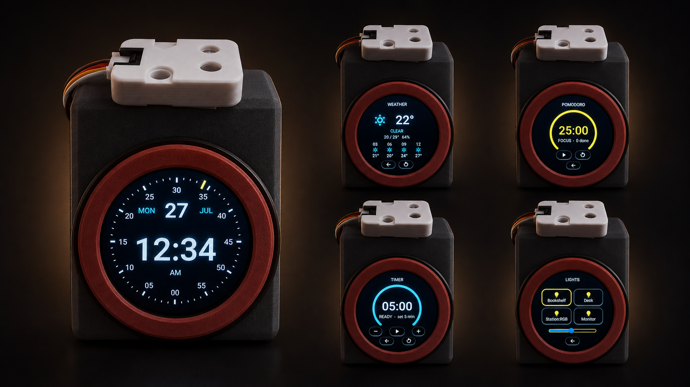
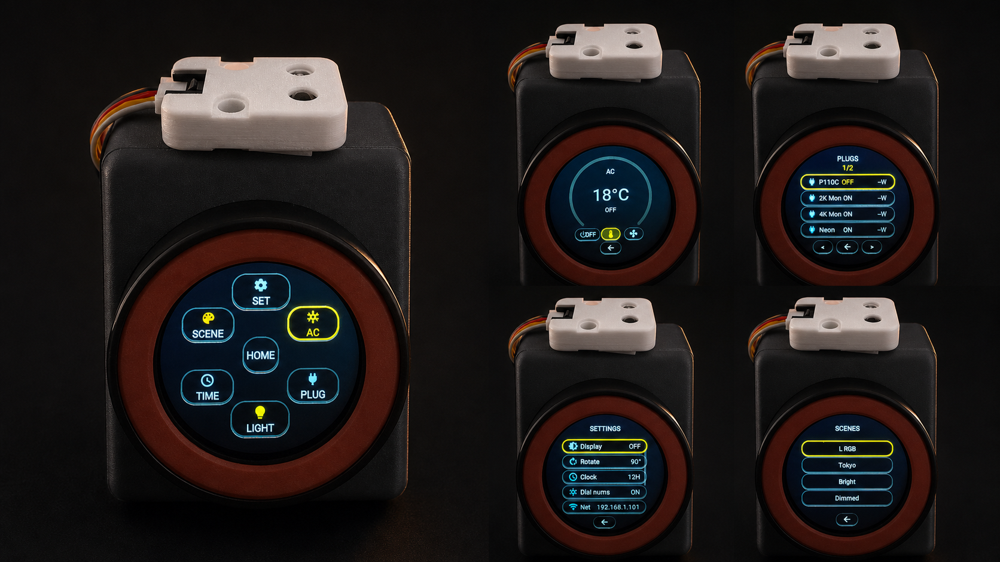

# DialHA

A desk controller for a Home Assistant home, built on the
[M5Stack Dial](https://docs.m5stack.com/en/core/M5Dial): a 240 px round touch
screen with a rotary encoder. It shows the time, world clocks and weather,
runs focus timers, switches lights, plugs and scenes through Home Assistant,
and drives an Arçelik air conditioner with infrared frames it computes itself.
ESPHome and LVGL underneath; UI cues from
[M5Dial-UserDemo](https://github.com/m5stack/M5Dial-UserDemo) and
[VolosR/M5Dial](https://github.com/VolosR/M5Dial).

**[Download the latest firmware](https://github.com/atahan99/DialHA/releases/latest)**
and flash it from the browser with [ESPHome Web](https://web.esphome.io)
(Chrome or Edge, Dial on USB-C).





## Engineering highlights

- The AC protocol was reverse-engineered from fifty captured frames, after a
  wrong first guess (Coolix) and some work to make the receiver report honest
  timings. Every command is computed on the fly, so nothing needs teaching and
  nothing is lost on reboot. [Full writeup](docs/ac-ir-protocol.md).
- Screenshots work without a framebuffer. The Dial has no PSRAM, so there are
  no 112 KB to spare for a copy of the screen; [`include/agent.h`](include/agent.h)
  copies LVGL's tiles on their way to the panel and streams them to the host.
  [`scripts/dial.py`](scripts/dial.py) rebuilds the PNG and can press every
  input, so UI changes get checked without photographing the glass.
- World clocks use the POSIX rule string at the end of each tzdata zone file,
  and a test compares them with the system tzdata every half hour for four
  years. The home zone comes from Home Assistant.
- Settings survive a pulled plug. ESPHome's `restore_value` stages on a 1 Hz
  poll and can lose the last change, so
  [`include/settings_store.h`](include/settings_store.h) writes immediately.
- [`check_ui.py`](check_ui.py) lints for a round screen: it fails when any
  button's corner falls outside the glass, along with other rules that each
  once cost a debugging session.
- One tree produces two builds: a public firmware with no secrets in it, built
  by CI for each tagged release, and the author's own build with credentials and debug
  tools.

## Hardware

| Piece | Notes |
|-------|--------|
| M5Dial (K130) | ESP32-S3, 240×240 GC9A01, encoder, touch, RTC, RFID, buzzer; no built-in IR |
| Unit IR U002 | Optional, for the AC page. PORT.B: TX = G2, RX = G1 |
| Power | Stays plugged in (USB or 6–36 V terminal) |
| Stand | [Angled Desk Stand with Pen Holder & USB-C Cable Channel](https://www.printables.com/model/1758751-m5stack-dial-angled-desk-stand-with-pen-holder-usb) by MintPrint, 3D printed |
| USB-C 90° adapter | Effectively required with that stand: a straight cable does not fit the channel, and the workaround (rotating the Dial 90°) puts the cable out the side |

**Do not enable `psram:`.** The module has none, which is also why there is no
framebuffer to copy for screenshots.

## Two builds

| | `dialha.factory.yaml` (public) | `m5dial.yaml` (personal) |
|---|---|---|
| Secrets in the `.bin` | none | Wi-Fi, OTA and AP passwords, API key |
| Wi-Fi | entered over USB right after flashing (Improv) | from `secrets.yaml` |
| API encryption key | set by Home Assistant on adoption | from `secrets.yaml` |
| Fallback hotspot | none | password-protected, off until Settings → AP |
| Updates | flash the next release over USB | OTA from your machine, password-protected |
| Debug API (`dial.py`, `ac_test.py`) | not included | [`packages/debug.yaml`](packages/debug.yaml) |

Both share [`packages/core.yaml`](packages/core.yaml). The time zone and the
weather location come from Home Assistant (`zone.home`) in both.

### Public build: first-time setup

1. Download `dialha-X.factory.bin` from the
   [latest release](https://github.com/atahan99/DialHA/releases/latest).
2. Open [ESPHome Web](https://web.esphome.io), connect the Dial, install the
   `.bin`, and enter your Wi-Fi when it asks.
3. Adopt the DialHA device Home Assistant discovers. That sets its API key.
4. Allow actions (below).

The public firmware holds no credentials, so it is careful about what it
accepts from the network. Wi-Fi is only set over the USB cable: an open
hotspot is not an option, because ESPHome's captive portal also takes firmware
uploads. It has no network OTA either; a new version is flashed over USB the
same way as the first. Until Home Assistant adopts it, any client on your LAN could set
the API key first, so adopt it soon after it joins the network.

The Lights, Plugs and Scenes pages point at the author's entity IDs. To use
your own, take control of the device in ESPHome Builder (the
`dashboard_import` link brings this repo in) and edit
[`packages/entities.yaml`](packages/entities.yaml).

### Personal build

Needs Python 3.12–3.14 and the ESPHome version in `requirements.txt`.

```bash
python3 -m venv .venv && source .venv/bin/activate
pip install -U pip && pip install -r requirements.txt
cp secrets.yaml.example secrets.yaml
```

Fill in `secrets.yaml` (Wi-Fi, OTA and AP passwords, and an API key from
`openssl rand -base64 32`), then put your HA entity IDs and labels in
[`packages/entities.yaml`](packages/entities.yaml). That file is committed and
is not secret.

```bash
./scripts/flash.sh                  # USB, auto-detects the port
./scripts/flash.sh 192.168.1.101    # OTA, once it is on Wi-Fi
esphome logs m5dial.yaml --device 192.168.1.101
```

`scripts/flash.sh` compiles, copies the factory image to `firmware/dialha.bin`
and uploads. See [firmware/README.md](firmware/README.md) for flashing without
ESPHome, recovering a wedged USB port, and why **the personal `.bin` contains
your Wi-Fi password and API key** and must never be shared.

| Symptom | Fix |
|---|---|
| Serial port missing | Hold BOOT (G0), tap RESET, release BOOT. Port is `/dev/cu.usbmodem*` |
| `waiting for download` after opening USB logs | Opening the port toggles DTR/RTS into ROM download mode. `esptool --chip esp32s3 --port <port> run`, then use network logs |
| Compiles, no device found | Same subnet? Try the raw IP rather than `m5-dial.local` |

### Allow actions in Home Assistant (both builds)

The Dial reads entity state without this, but **it cannot turn anything on or
off until actions are allowed**. That failure is silent and looks like a firmware bug.

1. In Settings → Devices & services, wait for discovery (up to ~5 min) and adopt the Dial
2. Open the device → Configure (gear) → enable "Allow the device to perform Home Assistant actions"
3. Tap a light on the Dial; HA should change. If not, check HA logs for denied `homeassistant.action` calls.

## UI

Industrial tick-ring clock, set by SNTP and Home Assistant and kept by the RTC. Single
tap wakes the backlight, double tap (or the front button) opens the
six-wedge launcher. Center HOME returns to the clock. Idle dims; Night
(22:00–08:00) and Display-off sleep. AP and Audio are off by default.
Every sub-page has a back arrow, and the side button is Back everywhere.

| Wedge | Page |
|-------|------|
| Settings | Display / Rotate / Clock / Dial nums / Network / Audio / Night / AP |
| AC | Arçelik 09325 A: temperature arc, fan, power (synthesised IR) |
| Lights | 2×2 HA light cards; tap toggles, dial sets brightness |
| Plugs | HA switches, 4 rows/page, `<`/`>` flips pages |
| Time | Hub ring → one dedicated page each (`packages/time.yaml`) |
| Scenes | HA `scene.*` activators |

The encoder and both buttons are wired straight to scripts
(`encoder_nav_cw` / `_ccw`, `front_or_wake`, `nav_back`), and the amber border
comes from a `*_index` global per page. There is deliberately no LVGL
`encoders:` indev. It adds a second, invisible selection (group focus), and
ESPHome puts every widget of every page into one flat group, so the encoder
walked focus onto other pages' widgets and the front button clicked them.

`front_action` snapshots the active page before dispatching, because several of
its handlers navigate; a live `lvgl.page.is_showing` chain fired the new page's
handler in the same press.

On the Lights page, the first tap on a card only selects it; tapping the selected
card toggles it (as does the front button), so the dial can be aimed at a light
without switching it and a mis-aimed tap costs nothing. The dial then changes
that light's brightness in 16/255 steps, sent to HA 250 ms after it settles (the
same debounce the AC uses). Brightness is held locally rather than read back from
HA, whose value lags a command by a refresh and would make the dial feel like it
was fighting back. The page re-reads HA once a second while it is on screen, so
changes made elsewhere show up.

Icons are Material Design Icons, subset to the glyphs actually used: `font_icon`
(18 px) plus 9 weather glyphs in `font_icon_big` (40 px). Codepoints are verified
against upstream `meta.json`; several are not the obvious value (`clock-outline`
is `F0150`, `brightness-6` is `F00DF`), so don't hand-edit them from memory.

The panel is a 240 px circle, so a widget whose corner
sits beyond r=120 is clipped by the glass. `check_ui.py` enforces r≤114 for every
button and slider on every page, plus a 24 px minimum touch height. Outer
Settings rows are deliberately narrower than inner ones so the list follows the
circle.

Rotate / Clock / Dial nums / Night / AP / Audio and the
AC state are stored by [`include/settings_store.h`](include/settings_store.h),
not by `restore_value: true`. ESPHome's restoring globals are a
`PollingComponent(1000)`: they stage on a 1 Hz poll and only reach flash on the
next preferences flush, so a setting changed just before the power is pulled is
lost (a clean reboot hides this, because `on_shutdown()` saves). `store_now()`
stages and commits in one call.

The Time wedge opens a launcher-style ring with the current time in
the middle. Each icon opens its own full page; the encoder adjusts that page's
value (city, timer minutes, pomodoro length).

```
clock ─tap─► launcher ─Time─► page_time (ring)
                                 ├─ page_cities     ← / →, 5 cities
                                 ├─ page_pomodoro   arc + play/reset
                                 ├─ page_stopwatch  play/reset, 0.1s
                                 ├─ page_timer      − / play / + / reset
                                 └─ page_weather    hero + 3-hourly strip
```

Cities are edited in `packages/entities.yaml`: a name and the POSIX zone
string tzdata ends that zone's file with (`tail -1 /usr/share/zoneinfo/Asia/Tokyo`),
with the IANA name as a comment. [`include/city_tz.h`](include/city_tz.h)
parses it and ESPHome's own converter does the rest, so daylight saving
switches on the right hour. `tests/run_city_tz_test.sh` checks every city
against the system tzdata; when a country changes its clocks (British Columbia
dropped daylight saving in November 2026), that test is what fails. When a city
is already on another date, its weekday is shown next to its name.

Weather (`packages/weather.yaml`) shows current conditions and today's high/low
from [Open-Meteo](https://open-meteo.com/en/docs), with no API key and no HA
weather entity. The location is Home Assistant's `zone.home`, rounded to two
decimals (about 1 km) before it leaves the device; `timezone=auto` derives the
local day from it. Refreshes every 15 min; the button on the page (or the front
button) forces one.

## AC: Arçelik 09325 A

Cool-only, and nothing needs teaching. The protocol was reverse-engineered
from 50 captured frames and every command is computed on the fly, so the Dial
works straight after a reboot or OTA. Full writeup:
[`docs/ac-ir-protocol.md`](docs/ac-ir-protocol.md).

- Arc shows the target temperature, 18–30 °C; fan is `AUTO` then 1–5 bars
- The power chip toggles; the front button (or the `TEMP`/`FAN` chips) picks what the dial adjusts
- Turning the dial sends one frame 400 ms after it settles, not one per detent
- Pressing the physical remote updates the Dial, because the receiver decodes the same format
- Each command is sent 5× (`ac_tx_repeats`, or `ac_set_repeats` at runtime). Frames are absolute state, so repeats are idempotent; this buys range, because the Unit IR's single LED is far weaker than a handheld remote's

A `component: ac_commit took a long time (~420 ms)` warning on transmit is
expected: one frame is ~52 ms, five with 40 ms gaps, and the transmitter
deliberately blocks (chunked sends get starved by LVGL).

Aiming matters more than anything in software. The AC's receiver window is
behind the front panel, pointing out and slightly down into the room, so
directly underneath the indoor unit is the worst possible spot. The Unit IR is
on a Grove cable and does not have to sit next to the Dial: put it where it can
see the front panel, or bounce it off a matte white ceiling. If commands are
still missed, raise `ac_tx_repeats`, or try `ac_carrier_hz: "36000"` / `"40000"`.
The carrier frequency was never measured (a demodulator strips it), so 38 kHz is
an assumption.

If the AC stops responding after a long uptime or many OTA flashes, reboot the
Dial: the ESP32's RMT transmitter has been seen to degrade, with frames still
leaving the device and logging normally.

### IR diagnostics (personal build)

```bash
python scripts/ac_test.py --host <ip> seq            # scripted on/temp/fan/off
python scripts/ac_test.py --host <ip> sweep-fan 24   # every fan step
python scripts/ac_test.py --host <ip> code 0x88C0051 # one exact frame
python scripts/decode_ir.py raw.txt                  # decode a `Received Raw:` dump
```

| Tool | Use |
|---|---|
| `ac_send_code` / `ac_set_state` | send exact frames from a host over the API |
| `ac_loopback` | decode our own emission; verifies the transmitted frame bit-for-bit |
| `ac_arm_capture` + `ac_replay` | store a remote frame verbatim and re-emit it, separating wrong bits from wrong timing |
| `ac_set_repeats` | change the repeat count at runtime |
| IR Beacon switch (HA) | re-sends state every 2 s so you can walk the emitter around |

## Driving it from a host (personal build)

`scripts/dial.py` works the UI over the ESPHome API and brings the screen back
as a PNG, enough to check a layout change or to let an agent drive the device
without photographing the glass.

```bash
python scripts/dial.py shot                  # -> shot.png
python scripts/dial.py key press cw:3 press  # cw / ccw / press / back
python scripts/dial.py key back shot         # keys and screenshots in one run
python scripts/dial.py logs -s 20            # stream the device log
```

The keys are the Dial's whole physical input surface, so anything a finger can
reach is reachable from here. **On the AC page they send real IR:** turning the
dial there changes your AC.

There is no framebuffer to snapshot: `ili9xxx` only allocates one for its own
drawing API, LVGL streams tiles straight to the panel, and a 240×240×2 = 112 KB
buffer will not fit in internal RAM (no PSRAM). So
[`include/agent.h`](include/agent.h) borrows the tiles on the way out: it swaps
in a flush callback, invalidates the screen, and mirrors each tile to a TCP
socket before handing it to ESPHome's real flush. This needs no extra RAM, and the host
reassembles the tiles into the PNG.

## Checks

CI runs the first three on every push.

```bash
python check_ui.py               # UI invariants, no device needed
tests/run_city_tz_test.sh        # world-clock zones against system tzdata
esphome config dialha.factory.yaml
python scripts/dial.py selftest  # screenshot decoder, no device needed
```

Releases: push a `v1.2.0` tag. [`release.yml`](.github/workflows/release.yml)
builds the public firmware at that version and attaches it to a GitHub release.

## Layout

```
dialha.factory.yaml      # public build (no secrets)
m5dial.yaml              # personal build (secrets.yaml + debug package)
check_ui.py              # UI invariants (styles, geometry, input model, persistence, no secrets)
packages/
  core.yaml               # everything both builds share
  debug.yaml              # API actions for dial.py / ac_test.py, IR beacon
  hardware.yaml           # pins, display, touch, encoder, RTC, NFC, time sources
  entities.yaml           # HA entity IDs + cities (committed)
  ac.yaml                 # Arçelik frame synthesiser + receive-sync
  time.yaml               # clock, cities, pomodoro, stopwatch, timer logic
  weather.yaml            # Open-Meteo fetch for HA's zone.home
  ui/                     # LVGL: base.yaml (styles, nav, clock, launcher) + one file per page
include/
  agent.h                 # screenshot bridge (LVGL flush tap → TCP)
  city_tz.h               # POSIX zone string parser for the Cities page
  settings_store.h        # immediate-write NVS persistence
  wx_icons.h              # WMO code -> weather glyph / word
  timefmt.h
scripts/
  flash.sh                # compile → firmware/dialha.bin → upload (USB or OTA)
  dial.py                 # screenshots + scripted input + logs over the API
  ac_test.py              # drive the AC over the API for bench testing
  decode_ir.py            # decode ESPHome raw IR dumps
tests/                   # city_tz host test
firmware/                # full factory .bin (gitignored) + README
docs/
  ac-ir-protocol.md       # how the IR protocol was decoded
  images/
```

MIT licensed; the compiled firmware is GPL-3.0 through ESPHome. See
[THIRD-PARTY.md](THIRD-PARTY.md).
